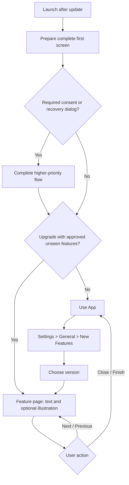

# New-version feature tour

Status: BL-021 implemented for local review; owner UAT/visual acceptance pending. The two text-only pages of the
[0.6.0 tour](tours/0.6.0-draft.md) are registered for prerelease review. Stable publication awaits final owner approval.

The current implementation uses text-only pages with an optional bundled App UI illustration slot. It never
packages game screenshots or game-derived images, and never captures a scene or starts a renderer for a tour.
`UIPopup_Sort` supplies the notice frame, close and navigation controls; `UIPopup_FilterSort` supplies the disabled
Previous state. Settings reuses `UIPopup_Option_PC` and its option button row. Sprites come from the user's install
through the existing asset routes, not bundled copies.

The first normal launch with this framework establishes a profile baseline when no launch history exists. It cannot
infer an earlier version from old preferences alone. Later normal upgrades queue approved versions above the
highest recorded launch; failed pre-renders remain pending. Presentation is acknowledged after the first page is
painted. Downgrades preserve the high-water version. State stays in the profile's existing `webui.json`, under
`tours`, and uses its shared atomic lock. Safe-mode launches do not advance this baseline; recovery dialogs defer presentation.

The hook runs after first-screen reveal and the consent/scan prompt sequence. Open update/recovery dialogs and
active jobs retain priority. A still-pending background update check does not hold up a local tour; its eventual
offer uses the existing idle queue. Missing tour content performs no prefab/image rendering. The UI neither
changes routes nor changes a retained scene's playback state; existing modal input gates remain in force.

## Entry and priority

1. An update downloads/installs through the existing flow and the App restarts normally.
2. The App prepares its first complete screen. Required consent, recovery and update-result dialogs take priority.
3. When the interface is idle, compare the current release with the last successfully launched version and the
   tour versions already presented in this user-data profile.
4. If this is an upgrade with approved, unseen feature pages, open the tour over the current screen. Otherwise
   continue into the App immediately. A first-ever installation does not interrupt setup with an upgrade tour;
   the current-version tour is available from Settings.

No tour requires a new game scan, live scene capture or download at startup. Approved presentation resources are
prepared with the release. Missing game data, missing Spine consent, offline use and safe/recovery mode must never
turn the tour into another startup blocker. Defer it during recovery; leave it available in Settings.

## Page composition and controls

Use the native App popup/gallery framing. Keep a short release heading and progress such as `2 / 4`, one feature
title, one or two short benefit/usage lines, and one optional approved App UI illustration. Do not add a second introduction-only page.
The illustration caption can identify a relevant button or location without a long tutorial.

| Control | Behavior |
| --- | --- |
| Close, top right | Return to the same App screen immediately |
| Previous | Go back one page; hidden/disabled on the first page |
| Next | Go forward one feature |
| Finish, final page | Close the tour and retain the current navigation context |
| Keyboard | Left/Right navigate; Escape closes; focus stays within the popup |
| Touch | Buttons remain primary; horizontal swiping can be an optional equivalent |

Do not automatically navigate into a feature, change a setting, install a Mod or restart a memorial lobby when a
tour page is selected. The owner can review a separate contextual action later; it is unnecessary for the first
implementation. Existing scene players remain retained/paused as appropriate behind the presentation.

## What appears after skipped versions

For an upgrade across several releases, collect the approved feature cards introduced after the previous version
and through the current one. Deduplicate by stable feature ID, use the most recent approved illustration/copy, and
show current-release highlights first. Only curated feature highlights belong in this tour; routine fixes and
implementation detail remain in Release Notes/CHANGELOG. A release with no approved feature cards shows no empty
tour. If earlier tour data is absent, show the available current highlights without inventing history.

Example: upgrading from 0.4.1 past 0.5.0 to a future stable 0.6.0 could show Student Hall, ZIP export and student
thumbnail photography as three separate pages, once the owner approves those actual release materials. The
current local 0.6.0-alpha build includes the two-page 0.6.0 tour for review. `approved: 'prerelease'` uses the
shared running-version prerelease gate, including development's `-dev`. The release core admits a `0.6.0` tour
during `0.6.0-alpha.9`; future prerelease versions still follow normal SemVer order. `approved: True` is reserved
for final owner approval. Presentation history uses `0.6.0` across this prerelease series and the eventual stable.

## Remembering presentation

Store launch/tour presentation state in the App user-data profile, separate from the shared Mod library and
preview cache. Record a tour version as presented only after its first page has actually rendered. Closing
halfway or finishing both prevent automatic repetition; reinstalling the same version and moving the Mod library
do not reset this state. A failed pre-render does not consume the presentation. Recording at first display also
prevents a crash after display from causing an automatic tour loop.

Downgrades do not auto-present old tours. Mark covered tour versions so switching back to an already viewed newer
version does not show them again. Asset corrections/copy revisions to an already presented release do not trigger
another automatic tour. Keep optional last-page/completion state separate from whether it was already presented.

## Settings replay

Place **New Features** in Settings' General tab, below Version. Opening it shows available versions, newest first,
with a short feature summary. Selecting a version opens the same page viewer from page one. Current-version and
earlier tours stay available without changing the App's remembered navigation. Closing a replay returns to the
version list/Settings rather than jumping to Student Hall. Manual viewing of an otherwise pending current tour
counts as presentation and avoids a second automatic popup later in that launch.

## Release preparation

1. Finalize the implemented feature list and update the developer-facing CHANGELOG.
2. The agent prepares user-facing feature cards in all six locales and optional plain illustrations of the App's
   own UI. Never package screenshots or images made from game files. Text-only pages are supported.
3. Hand the concrete copy and any illustrations to the human owner together. Label illustration concepts as drafts;
   do not treat them as screenshots or approved publication assets.
4. After human review, package only approved tour materials for the corresponding release. Keep raw game files,
   exported caches and development fixtures out of distributables; follow the repository's game-asset policy.
5. Test version gating, dismiss/replay, keyboard navigation, missing images, offline launch, skipped upgrades,
   downgrades, copied profiles and crash recovery. The owner handles UAT and visual acceptance.

BL-020 Release Notes provide the complete user-facing changes for a detected release. `CHANGELOG.MD` records
developer-oriented version history. BL-021 is the concise feature introduction; none substitutes for
the others.
